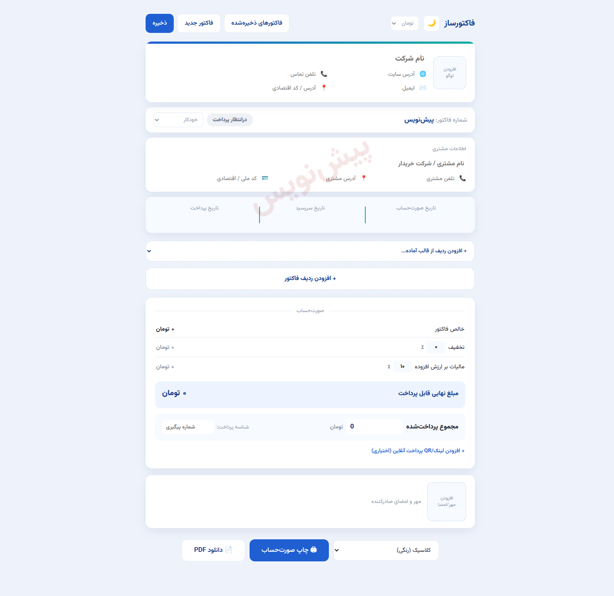

# فاکتورساز فارسی 🧾

فاکتورساز فارسی یک ابزار تک‌فایلی و سبک برای صدور فاکتور حرفه‌ای است — رابط راست‌به‌چپ، اعداد فارسی، شماره‌گذاری خودکار بر اساس سال شمسی و خروجی چاپ/PDF با ۹ قالب زیبا. بدون هیچ فریم‌ورکی، فقط PHP و JavaScript خالص.



## ✨ امکانات

- 📝 **ویرایش زنده** — همه‌ی عنوان‌ها، ردیف‌ها و مبالغ مستقیم روی خود فاکتور قابل ویرایش‌اند
- 🔢 **شماره‌گذاری خودکار** — شماره فاکتور به‌صورت «سال شمسی-ردیف» (مثل `1405-1001`) صادر می‌شود
- 🧩 **قالب‌های آماده‌ی ردیف** — هاستینگ، طراحی وب‌سایت، ثبت دامنه، گواهی SSL و پشتیبانی ماهانه
- 🖱️ **درگ‌اند‌دراپ ردیف‌ها** + مشخصات فنی با آیکون خودکار و جمع جزئی هر ۳ ردیف
- 💰 **محاسبات کامل** — تخفیف، مالیات بر ارزش افزوده، و تبدیل خودکار مبلغ نهایی **به حروف فارسی**
- 💳 **پیگیری پرداخت** — مبلغ پرداخت‌شده، شناسه پرداخت، لینک پرداخت با کد QR و وضعیت خودکار (پرداخت‌شده / جزئی / در انتظار / معوق / لغو)
- 🔒 **قفل ویرایش** — فاکتور پرداخت‌شده برای جلوگیری از تغییر اشتباهی قفل می‌شود
- 🗂️ **آرشیو فاکتورها** — ذخیره، جستجو، بارگذاری، کپی و حذف (ذخیره‌سازی در `invoices.json`)
- 🖨 **چاپ و PDF** — ۹ قالب خروجی: کلاسیک، رسمی/اداری، شرکتی سرمه‌ای، مینیمال، مدرن بنفش، فیروزه‌ای، بولد، گرم و تیره‌ی طلایی
- 🌙 **حالت تاریک** و لوگو/مهر با آپلود تصویر

## 🚀 اجرا

فقط PHP (نسخه ۷.۴+) لازم است — بدون دیتابیس، بدون نصب:

```bash
php -S localhost:8000
```

بعد `http://localhost:8000` را باز کنید. برای هاست اشتراکی هم کافیست `index.php` را در یک پوشه کپی کنید.

## ⚠️ نکته امنیتی

- فایل `invoices.json` حاوی داده‌ی فاکتورهاست و در گیت نادیده گرفته شده؛ آن را منتشر نکنید.
- این ابزار احراز هویت ندارد؛ اگر روی هاست عمومی می‌گذاریدش، حتماً پوشه را با رمز (مثل `.htpasswd`) محافظت کنید.

## 🌐 سازنده | Made by

ساخته‌شده توسط **[تایمیت — timit.ir](https://timit.ir/)** — مرجع آموزش وردپرس فارسی و خدمات طراحی سایت، سئو و دیجیتال مارکتینگ. 💙

Built by **[Timit — timit.ir](https://timit.ir/)** — Persian WordPress education, web design, SEO & digital marketing.

## 📄 License

MIT — see [LICENSE](LICENSE).
